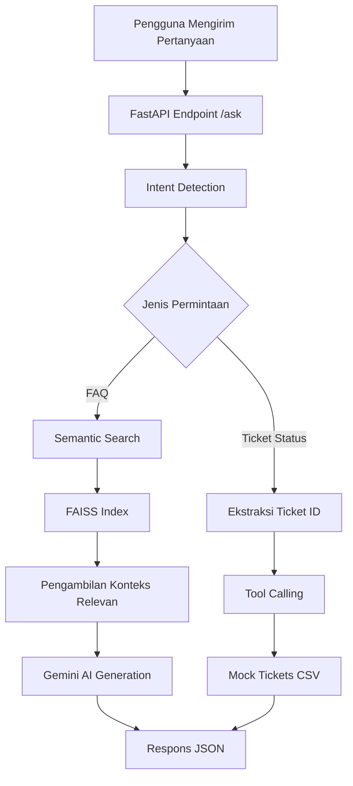

# IT Helpdesk Assistant — RAG & AI Agent

Aplikasi AI Helpdesk yang mengintegrasikan Retrieval-Augmented Generation (RAG) dan Tool Calling untuk membantu karyawan memperoleh informasi layanan IT perusahaan serta memeriksa status tiket secara otomatis.

## 1. Gambaran Umum Proyek

IT Helpdesk Assistant merupakan aplikasi berbasis Artificial Intelligence (AI) yang dirancang untuk membantu karyawan memperoleh informasi mengenai kebijakan, prosedur, dan layanan IT perusahaan melalui satu sistem terintegrasi.

Aplikasi ini menggabungkan teknologi **Retrieval-Augmented Generation (RAG)** dengan mekanisme **Tool Calling** menggunakan backend FastAPI dan Google Gemini API.

Sistem memiliki dua fungsi utama:

1. **FAQ Assistant (RAG):** Menjawab pertanyaan pengguna berdasarkan informasi yang tersedia dalam knowledge base perusahaan melalui proses semantic search dan pembangkitan jawaban menggunakan Gemini.
2. **Ticket Status Checker (Tool Calling):** Mengidentifikasi permintaan pengecekan tiket, mengambil Ticket ID, dan mencari informasi status tiket dari database mock.

Proyek ini dikembangkan sebagai bagian dari Individual Assignment: End-to-End RAG & AI Agent Development pada program AI Engineering Bootcamp.

## 2. Tujuan Pengembangan

Tujuan pengembangan aplikasi ini adalah:

- Membangun sistem RAG yang mampu melakukan pencarian informasi menggunakan semantic search dan FAISS.
- Mengintegrasikan Google Gemini API untuk menghasilkan jawaban berdasarkan konteks knowledge base.
- Mengimplementasikan intent detection untuk membedakan pertanyaan FAQ dan pengecekan status tiket.
- Mengimplementasikan Tool Calling untuk mengambil informasi tiket berdasarkan Ticket ID.
- Mengembangkan backend API menggunakan FastAPI.
- Mengelola kredensial API melalui environment variables.
- Mengemas aplikasi menggunakan Docker.
- Melakukan pengujian untuk memastikan seluruh komponen aplikasi berjalan sesuai fungsinya.

## 3. Teknologi yang Digunakan

| Teknologi | Fungsi |
|---|---|
| Python 3.11 | Bahasa pemrograman utama |
| FastAPI | Framework backend API |
| FAISS | Pengelolaan dan pencarian indeks vektor |
| Google Gemini API | Menghasilkan jawaban berbasis konteks |
| Embedding | Merepresentasikan dokumen dan pertanyaan dalam bentuk vektor |
| Semantic Search | Mencari informasi berdasarkan kemiripan makna |
| Uvicorn | Menjalankan aplikasi FastAPI |
| Docker | Mengemas dan menjalankan aplikasi dalam container |
| Git & GitHub | Pengelolaan versi dan pengumpulan proyek |

## 4. Struktur Proyek

```text
it_helpdesk_assignment/
│
├── app/
│   ├── main.py
│   ├── router.py
│   ├── rag.py
│   └── tools.py
│
├── data/
│   ├── it_helpdesk_knowledge_base.csv
│   └── mock_tickets.csv
│
├── .dockerignore
├── .env.example
├── .gitignore
├── Dockerfile
├── requirements.txt
└── README.md
```

### Penjelasan Komponen

| File | Fungsi |
|---|---|
| `main.py` | Menjalankan aplikasi FastAPI dan menyediakan endpoint API. |
| `router.py` | Melakukan deteksi intent dan mengarahkan pertanyaan ke RAG atau Tool Calling. |
| `rag.py` | Menangani embedding, pembangunan FAISS index, semantic search, dan generasi jawaban Gemini. |
| `tools.py` | Mengambil informasi status tiket dari data mock. |
| `it_helpdesk_knowledge_base.csv` | Menyimpan kumpulan FAQ layanan dan kebijakan IT perusahaan. |
| `mock_tickets.csv` | Menyimpan data tiket untuk kebutuhan Tool Calling. |
| `Dockerfile` | Mengatur proses pembangunan Docker image. |
| `.env.example` | Menyediakan template konfigurasi environment variables. |

## 5. Arsitektur dan Alur Kerja Sistem

Aplikasi memproses pertanyaan pengguna melalui mekanisme intent detection dan routing.



### 5.1. Alur Kerja RAG

Pada jalur FAQ, sistem menjalankan proses berikut:

1. Menerima pertanyaan dari pengguna.
2. Mengubah pertanyaan menjadi representasi embedding.
3. Melakukan pencarian semantik menggunakan FAISS.
4. Mengambil dokumen yang relevan dari knowledge base.
5. Menyusun prompt berdasarkan pertanyaan dan konteks hasil retrieval.
6. Mengirimkan prompt kepada Google Gemini API.
7. Menghasilkan jawaban berdasarkan informasi yang ditemukan.
8. Mengembalikan jawaban beserta referensi FAQ.

Knowledge base yang digunakan terdiri atas 31 dokumen FAQ, sesuai hasil pemeriksaan endpoint health check.

### 5.2. Alur Kerja Tool Calling

Pada jalur pengecekan status tiket, sistem menjalankan proses berikut:

1. Menerima pertanyaan pengguna.
2. Mendeteksi intent `ticket_status`.
3. Mengekstrak Ticket ID dari pertanyaan.
4. Memanggil fungsi pengecekan status tiket.
5. Mencari Ticket ID pada data `mock_tickets.csv`.
6. Mengembalikan informasi tiket apabila ditemukan.
7. Mengembalikan respons `not_found` apabila tiket tidak ditemukan.

### 5.3. Kategori Intent

| Intent | Keterangan |
|---|---|
| `faq` | Pertanyaan mengenai kebijakan, prosedur, dan layanan IT perusahaan. |
| `ticket_status` | Permintaan informasi mengenai status tiket IT berdasarkan Ticket ID. |

## 6. Konfigurasi Environment

Aplikasi menggunakan environment variables untuk mengelola Google Gemini API Key.

Buat file `.env` berdasarkan template `.env.example`.

Contoh konfigurasi:

```env
GEMINI_API_KEY=your_gemini_api_key_here
```

Ganti placeholder tersebut dengan API Key Gemini yang valid.

**Keamanan konfigurasi:**

- Jangan mengunggah file `.env` ke repository GitHub.
- Gunakan `.env.example` sebagai template konfigurasi.
- File `.gitignore` digunakan untuk mengecualikan file sensitif dari Git.
- File `.dockerignore` digunakan untuk mengecualikan file sensitif dan file pengembangan yang tidak diperlukan dari Docker build context.

## 7. Instalasi dan Menjalankan Aplikasi

### 7.1. Menjalankan Aplikasi Secara Lokal

**Persyaratan:**

- Python 3.11
- pip
- Google Gemini API Key

**Langkah 1 — Membuat virtual environment**

```powershell
python -m venv .venv
```

**Langkah 2 — Mengaktifkan virtual environment**

```powershell
.\.venv\Scripts\Activate.ps1
```

**Langkah 3 — Menginstal dependencies**

```powershell
python -m pip install -r requirements.txt
```

**Langkah 4 — Membuat konfigurasi environment**

```powershell
Copy-Item .env.example .env
```

Masukkan Gemini API Key ke dalam file `.env`.

**Langkah 5 — Menjalankan aplikasi**

```powershell
uvicorn app.main:app --reload
```

Setelah aplikasi berjalan, akses melalui:

- API: http://localhost:8000
- Dokumentasi Swagger: http://localhost:8000/docs
- Health Check: http://localhost:8000/health

### 7.2. Menjalankan Aplikasi Menggunakan Docker

**Langkah 1 — Membangun Docker image**

```powershell
docker build -t it-helpdesk-assistant .
```

**Langkah 2 — Menjalankan Docker container**

```powershell
docker run --name it-helpdesk-container -p 8000:8000 --env-file .env it-helpdesk-assistant
```

**Langkah 3 — Memeriksa status container**

```powershell
docker ps
```

**Langkah 4 — Melihat log aplikasi**

```powershell
docker logs -f it-helpdesk-container
```

**Langkah 5 — Mengakses aplikasi**

Buka Swagger UI melalui:

http://localhost:8000/docs

Aplikasi dapat diakses melalui port 8000 dari komputer host.

## 8. Endpoint API

Aplikasi menyediakan dua endpoint utama.

### 8.1. Health Check

**Method:** GET

**Endpoint:**

```text
/health
```

Endpoint ini digunakan untuk memeriksa kondisi aplikasi, status pemuatan FAISS index, dan jumlah dokumen yang tersedia.

Contoh respons:

```json
{
  "status": "ok",
  "rag_index_loaded": true,
  "total_documents": 31
}
```

### 8.2. Ask Endpoint

**Method:** POST

**Endpoint:**

```text
/ask
```

Endpoint ini menerima pertanyaan pengguna dan mengarahkannya ke komponen RAG atau Tool Calling berdasarkan intent yang terdeteksi.

Contoh request:

```json
{
  "query": "Apa yang harus dilakukan jika laptop kantor mengalami kerusakan?"
}
```

Contoh struktur response:

```json
{
  "status": "success",
  "intent": "faq",
  "data": "Jawaban berdasarkan knowledge base."
}
```

Penjelasan field:

| Field | Keterangan |
|---|---|
| `status` | Hasil pemrosesan permintaan. |
| `intent` | Kategori permintaan yang terdeteksi. |
| `data` | Jawaban FAQ atau informasi status tiket. |

## 9. Skenario dan Hasil Pengujian

Pengujian dilakukan melalui Swagger UI menggunakan endpoint `POST /ask` dan `GET /health`.

Lima skenario berikut digunakan untuk memvalidasi fungsi utama aplikasi.

### TC-01 — Pengujian FAQ: Reset Password VPN

**Pertanyaan:**

```text
Bagaimana cara melakukan reset password VPN perusahaan?
```

**Routing yang diharapkan:** RAG

**Hasil pengujian:** PASS

Sistem berhasil menemukan FAQ ID 8 dan menghasilkan jawaban mengenai proses reset password VPN melalui portal self-service IT serta menghubungi IT Support apabila akun terkunci.

**Observasi:** Sistem berhasil mengambil informasi yang relevan dari knowledge base dan menghasilkan jawaban yang sesuai dengan konteks.

### TC-02 — Pengujian FAQ: Laptop Kerja Rusak

**Pertanyaan:**

```text
Apa yang harus dilakukan jika laptop kantor mengalami kerusakan?
```

**Routing yang diharapkan:** RAG

**Hasil pengujian:** PASS

Sistem berhasil menemukan FAQ ID 15 dan menghasilkan informasi berikut:

- Melaporkan kerusakan melalui tiket IT.
- Memilih kategori `Hardware Issue`.
- Menyertakan deskripsi masalah secara jelas.
- Tim IT dapat memberikan unit pengganti sementara apabila diperlukan.

**Observasi:** Jawaban yang dihasilkan mempertahankan informasi penting dari knowledge base dan mencantumkan referensi FAQ yang sesuai.

### TC-03 — Pengujian Tool Calling: Tiket Ditemukan

**Pertanyaan:**

```text
Apa status tiket TICKET-0002?
```

**Routing yang diharapkan:** Tool Calling

**Hasil pengujian:** PASS

Sistem berhasil menemukan data tiket dengan informasi berikut:

| Informasi | Hasil |
|---|---|
| Ticket ID | TICKET-0002 |
| Nama Karyawan | Sari Dewi |
| Kategori | Access |
| Subjek | Permintaan akses Google Analytics |
| Status | Diproses |
| Pembaruan Terakhir | 2026-08-25 |

**Observasi:** Sistem berhasil mendeteksi permintaan pengecekan tiket, mengekstrak Ticket ID, dan mengambil informasi yang sesuai dari database mock.

### TC-04 — Pengujian Tool Calling: Tiket Tidak Ditemukan

**Pertanyaan:**

```text
Apa status tiket TICKET-9999?
```

**Routing yang diharapkan:** Tool Calling

**Hasil pengujian:** PASS

Contoh respons:

```json
{
  "status": "not_found",
  "intent": "ticket_status",
  "data": "Tiket TICKET-9999 tidak ditemukan dalam database."
}
```

**Observasi:** Sistem berhasil mengenali bahwa Ticket ID tidak tersedia dalam database dan memberikan respons `not_found` tanpa mengarang informasi tiket.

### TC-05 — Pengujian Pertanyaan di Luar Cakupan (Out-of-Scope)

**Pertanyaan:**

```text
Bagaimana cara membuat rendang Padang yang enak?
```

**Routing yang diharapkan:** Penanganan pertanyaan di luar cakupan melalui jalur FAQ.

**Hasil pengujian:** PASS

Sistem memberikan respons bahwa informasi mengenai cara membuat rendang tidak ditemukan dalam knowledge base dan menjelaskan bahwa sistem hanya memberikan informasi terkait kebijakan serta layanan IT perusahaan.

**Observasi:** Sistem berhasil menangani pertanyaan yang tidak berkaitan dengan layanan IT tanpa menghasilkan informasi yang tidak didukung oleh knowledge base.

### 9.1. Pengujian Tambahan

Selain lima skenario utama, dilakukan pengujian tambahan untuk mengevaluasi kemampuan retrieval dan kelengkapan respons.

| Pengujian | Pertanyaan | Hasil |
|---|---|---|
| Paraphrase Test | Notebook kantor tiba-tiba rusak dan pengguna meminta bantuan IT. | PASS — Sistem menemukan FAQ ID 15. |
| Unsupported IT Query | Printer kantor mengalami paper jam. | PASS — Sistem menyatakan informasi belum tersedia. |
| Long Answer Validation | Prosedur penanganan laptop rusak. | PASS — Jawaban lengkap dan tidak terlihat terpotong. |
| Health Check | GET `/health`. | PASS — FAISS berhasil dimuat dengan 31 dokumen. |

### 9.2. Rekapitulasi Hasil Pengujian

| Komponen | Hasil |
|---|---|
| FAQ Retrieval | PASS |
| Gemini Answer Generation | PASS |
| Semantic Paraphrase Retrieval | PASS |
| Ticket Status Lookup | PASS |
| Ticket Not Found Handling | PASS |
| Out-of-Scope Handling | PASS |
| FastAPI Endpoint | PASS |
| Docker Execution | PASS |
| RAG Health Check | PASS |

## 10. Verifikasi Docker

Pengujian Docker dilakukan untuk memastikan aplikasi dapat dijalankan dalam lingkungan container.

Berdasarkan hasil pengujian:

- Docker image berhasil dibangun.
- Docker container berhasil dijalankan.
- FastAPI berhasil menyelesaikan proses startup.
- Uvicorn berhasil menjalankan aplikasi pada port 8000.
- Endpoint `/ask` berhasil menerima permintaan dari luar container.
- Endpoint `/health` memberikan respons yang sesuai.
- FAISS index berhasil dimuat.
- Sistem berhasil mendeteksi 31 dokumen knowledge base.
- Log Gemini menunjukkan proses generasi selesai secara normal pada pengujian yang diperiksa.

Hasil tersebut menunjukkan bahwa aplikasi berhasil dijalankan menggunakan Docker dan komponen utama RAG dapat dimuat dengan baik.

## 11. Keterbatasan Sistem

Aplikasi yang dikembangkan masih memiliki beberapa keterbatasan:

1. **Ketergantungan pada Knowledge Base:** Jawaban FAQ bergantung pada informasi yang tersedia dalam knowledge base. Sistem tidak dapat memberikan informasi spesifik yang tidak ditemukan dalam dokumen.
2. **Database Tiket Mock:** Pengecekan status tiket masih menggunakan data mock dalam format CSV dan belum terhubung dengan sistem ticketing perusahaan secara langsung.
3. **Kategori Intent Terbatas:** Router saat ini menangani dua kategori intent utama, yaitu `faq` dan `ticket_status`.
4. **Ketergantungan API Eksternal:** Generasi jawaban menggunakan Gemini membutuhkan API Key yang valid dan akses ke layanan Gemini API.
5. **Deployment Lokal:** Aplikasi telah diuji menggunakan Docker di lingkungan lokal dan belum diimplementasikan pada layanan cloud.
6. **Cakupan Knowledge Base:** Kualitas dan relevansi jawaban bergantung pada kelengkapan informasi yang tersedia dalam knowledge base.

## 12. Kesimpulan

IT Helpdesk Assistant berhasil dikembangkan sebagai aplikasi AI yang mengintegrasikan Retrieval-Augmented Generation dan Tool Calling dalam satu backend API.

Sistem mampu melakukan pencarian informasi menggunakan semantic search dan FAISS, menghasilkan jawaban berdasarkan konteks knowledge base melalui Google Gemini, serta mengambil informasi status tiket melalui fungsi Tool Calling.

Hasil pengujian menunjukkan bahwa aplikasi mampu menangani pertanyaan FAQ, pertanyaan dengan susunan kata berbeda, pengecekan tiket yang ditemukan, pengecekan tiket yang tidak ditemukan, serta pertanyaan di luar cakupan knowledge base.

Selain itu, aplikasi berhasil dikemas dan dijalankan menggunakan Docker dengan pengelolaan kredensial API melalui environment variables.

Dengan demikian, implementasi proyek telah memenuhi tujuan utama pengembangan AI Helpdesk Assistant dalam assignment End-to-End RAG & AI Agent Development.